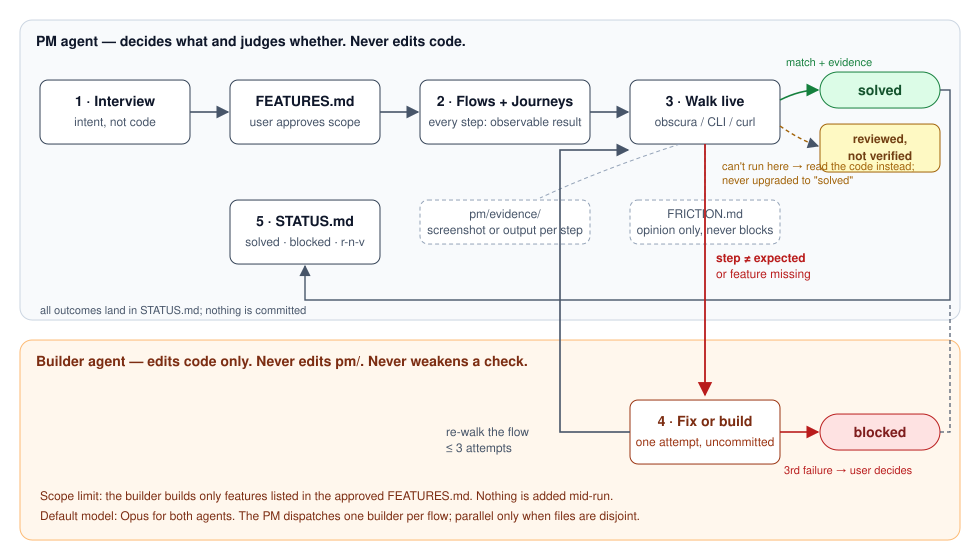

# PM Method

[](LICENSE)

**An AI product manager that owns the definition of done, and a separate builder that is never allowed to grade its own work.**

Coding agents finish fast and report "done" for work that is not done, because the same model writes the code and judges it. PM Method splits the two. A **PM agent** writes what the software must do, derives every user flow and user journey from it, and walks each one live against the running software. A **builder agent** fixes or builds code when a walk fails. The builder cannot touch the checks. The PM cannot touch the code.



## Install

Claude Code, in any project:

```bash
git clone https://github.com/Exorust/pm-method ~/.claude/skills/_pm-method-src
ln -s ~/.claude/skills/_pm-method-src/skills/pm-method ~/.claude/skills/pm-method
```

Then type `/pm-method` in the project you are building.

## What a run does

| Step | PM agent | Output |
|---|---|---|
| 1 | Reads README, issues, design docs. Interviews you. **Never derives features from the code**, because code can only tell you what exists, not what is missing. Then checks the code and marks each feature built / partial / missing. | `pm/FEATURES.md` — you approve it |
| 2 | Writes one flow per task inside each feature, with error paths, and 3–5 journeys that cross features (one per user type). Every step has an **observable expected result**. | `pm/flows/*.md`, `pm/journeys.md` |
| 3 | Starts the software and walks every flow and journey, every run. Passes a step only when what it sees matches the written result. Saves a screenshot or output per step. Writes opinion notes on friction, which never block a pass. | `pm/evidence/`, `pm/FRICTION.md` |
| 4 | Dispatches a builder agent for each failed or missing flow with a self-contained brief. Re-walks. Up to 3 attempts, then `blocked`. | uncommitted code changes |
| 5 | Reports counts, every blocked item with its last error, files changed, top friction notes. Commits nothing. | `pm/STATUS.md` |

## Four statuses, and what they actually mean

| Status | Meaning |
|---|---|
| `solved` | Walked against the running software. Every step matched. Evidence saved. |
| `blocked` | Builder failed 3 attempts. Last error in STATUS.md. You decide. |
| `reviewed-not-verified` | Could not run here (mobile without emulator, production credentials). PM read the code instead. **Never promoted to solved without a real walk.** |
| `not-started` | In the approved FEATURES.md, no code yet. Builder builds it this run. |

## Design decisions

These were settled one at a time. Each lists the option that lost and when it would have won.

| Decision | Choice | Lost, and when it wins |
|---|---|---|
| What proves a flow is solved | A live walk against running software | Code review alone: wins when the software cannot run, so it survives as the `reviewed-not-verified` fallback |
| Where features come from | Your intent (docs + interview), then checked against code | Code only: wins when documenting an inherited project, not finishing one |
| Flow vs journey | Flow = one task in one feature. Journey = one user type across features | Journey as emotion map: wins when the readers are designers, not the builder |
| Who fixes | Separate builder agent that cannot edit checks | One agent: wins on tiny projects you watch line by line |
| How checks run | Live walk each run, evidence per step | Test files: wins past ~15 flows, when full walks get slow; also gives CI something to run |
| Trigger | By hand, everything every run | Diff-only: wins on large projects; automatic: wins once you trust `blocked` reports |
| Missing features | Builder builds them, limited to approved FEATURES.md | Ask per run: wins when you want to control scope on every run |

## Layout

```
skills/pm-method/SKILL.md      the skill
skills/pm-method/templates.md  shapes for FEATURES, flows, journeys, STATUS, FRICTION, builder brief
docs/images/                   the loop diagram
```

## Known limits

- Live walks cost tokens on every run. Past about 15 flows, add test files.
- The PM's judgement is the only grader. The written expected results and the saved evidence are the controls on it.
- Builder changes are left uncommitted. A run that builds many features produces one large diff; review per feature.

## License

MIT
